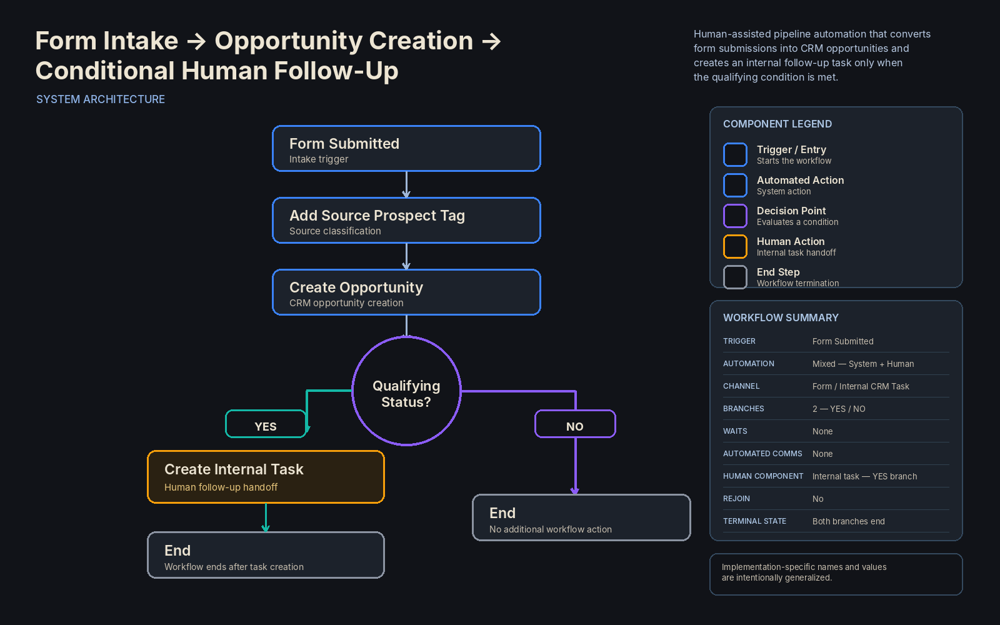

# Form Intake → Opportunity Creation → Conditional Human Follow-Up

## Overview

A human-assisted pipeline automation designed to convert form submissions into CRM opportunities and selectively create an internal follow-up task when a qualifying status condition is met.

The workflow combines form-based intake, source classification, opportunity creation, conditional routing, and targeted human escalation.

Automation handles the intake and qualification logic, while human intervention occurs only when the configured condition evaluates positively.

## Business Problem

Form submissions can create new prospects, but not every prospect requires the same follow-up process.

Without conditional routing, every submission could require manual review regardless of its current status.

This workflow converts each form submission into an opportunity, evaluates a designated contact field, and creates a human follow-up task only when the configured qualifying value is present.

Contacts that do not meet the condition reach the end of the workflow without additional actions.

## System Architecture



### Core Components

- Form submission trigger
- Prospect source tagging
- CRM opportunity creation
- Configured pipeline placement
- Status-field evaluation
- Conditional YES / NO routing
- Internal task creation
- Selective human follow-up
- Direct terminal paths
- No waits
- No automated customer communications
- No branch rejoin

## High-Level Flow

```text
Form Submitted
↓
Add Source Prospect Tag
↓
Create Opportunity
↓
Check Status Field
│
├── YES — Qualifying Status
│   ↓
│   Create Internal Task
│   ↓
│   End
│
└── NO — Any Other Value
    ↓
    End
```

## Design Decisions

### Form-Based Entry

The workflow begins when the configured intake form is submitted.

The specific form used in the implementation has been generalized in this case study.

### Source Classification

After entry, the workflow applies the functional `source_prospect` tag.

This identifies the contact as a prospect originating from the intake source associated with the workflow.

### Opportunity Creation

The workflow creates a CRM opportunity for the contact before evaluating the follow-up condition.

The opportunity is placed into the configured pipeline and initial pipeline stage.

Specific pipeline and stage values are intentionally abstracted from the public documentation.

### Conditional Routing

After the opportunity is created, the workflow evaluates a designated contact status field.

The condition compares that field against the configured qualifying value.

```text
status field == qualifying status?
├── YES → Create Internal Task
└── NO  → End
```

The workflow does not create or modify the status value as part of this documented sequence.

It only evaluates the value already present when the condition is reached.

### Selective Human Escalation

When the condition evaluates `YES`, the workflow creates an internal task for the assigned user.

The task directs the responsible person to review the contact and perform the required follow-up.

The automation ends immediately after task creation.

Task creation represents the handoff to the human operator; the workflow does not verify completion of the subsequent human follow-up.

### Direct Non-Qualifying Path

When the evaluated status does not match the qualifying value, the workflow reaches its end without creating a task or performing any additional action.

There is no rejoin between the two branches.

## Functional Tag Model

The workflow applies one functional tag.

| Tag | Function |
|---|---|
| `source_prospect` | Identifies the contact as a prospect originating from the associated intake source |

The qualifying status is not a workflow state or tag.

It is a value evaluated within the conditional routing step.

## Condition Model

The workflow uses one routing condition.

```text
Configured Status Field
↓
Equals Configured Qualifying Value?
├── YES → Human Follow-Up Task
└── NO  → End
```

Any value that does not satisfy the configured qualifying condition follows the `NO` branch.

## Human Component

Human intervention occurs only on the qualifying path.

### Human Role

The internal task is assigned to the configured responsible user.

### Human Action

The assigned user is expected to:

- Review the prospect
- Perform the follow-up indicated by the task

### Handoff Point

```text
Qualifying Status
↓
Create Internal Task
↓
Workflow Ends
↓
Human Follow-Up
```

The human action occurs after the automated workflow has completed its routing logic.

## Branch Behavior

### Qualifying Path

```text
Form Submitted
↓
Add Source Prospect Tag
↓
Create Opportunity
↓
Status Condition = YES
↓
Create Internal Task
↓
End
```

### Non-Qualifying Path

```text
Form Submitted
↓
Add Source Prospect Tag
↓
Create Opportunity
↓
Status Condition = NO
↓
End
```

Neither branch contains a wait, automated customer communication, or rejoin.

## Automation Model

This workflow uses a mixed automation model.

The system automatically handles:

- Form intake
- Source tagging
- Opportunity creation
- Status evaluation
- Conditional routing
- Internal task creation

Human intervention occurs only after the qualifying branch creates the internal task.

The workflow itself does not perform or confirm the human follow-up.

## Privacy & Anonymization

This portfolio case study has been intentionally abstracted.

Client names, proprietary form names, source-specific tag names, pipeline names, pipeline stages, contact-field names, qualifying values, assigned-user information, task titles, task instructions, internal identifiers, credentials, and implementation-specific business data have been removed or generalized.

The case study demonstrates intake architecture, pipeline automation, conditional routing, and selective human escalation without exposing confidential client information or proprietary implementation details.