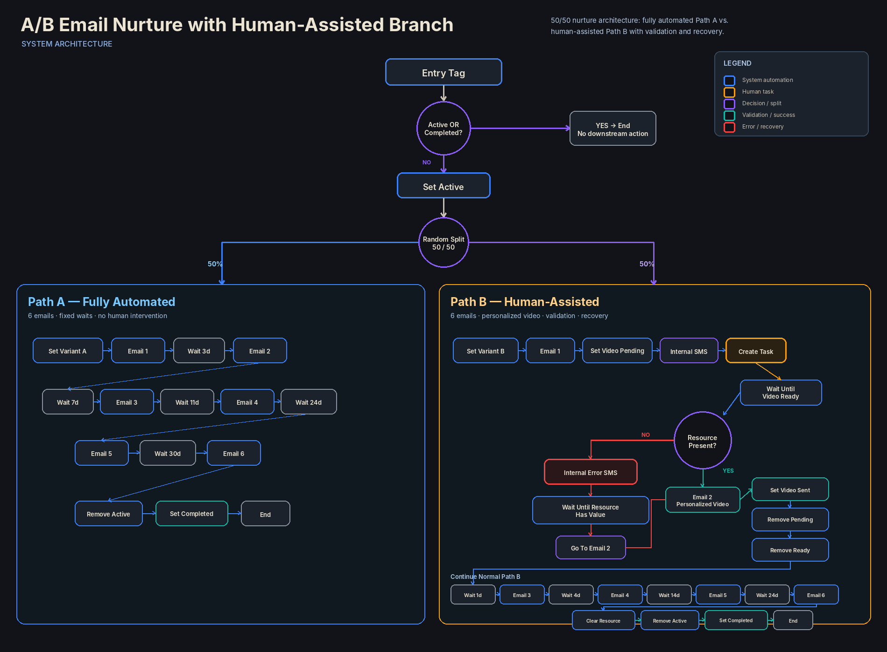

# A/B Email Nurture with Human-Assisted Branch

## Overview

A mixed automation workflow designed to distribute contacts between two 50/50 email nurture variants.

Path A runs as a fully automated six-email sequence.

Path B combines automated nurturing with a human-created personalized video, a readiness signal, required-resource validation, exception recovery, and continued automated follow-up.

The workflow also uses entry-state controls to prevent contacts that are already active or completed from progressing through the nurture sequence again.

## Business Problem

A nurturing strategy may need to compare a fully automated experience with a more personalized journey that depends on human preparation.

These two approaches have different operational requirements.

The automated path can progress entirely through scheduled email and wait actions.

The human-assisted path cannot safely continue until the personalized resource has been prepared, stored, and validated.

The system must therefore coordinate A/B assignment, prevent unintended re-entry, pause the assisted branch while human work is pending, verify the required resource before delivery, recover when the resource is missing, and leave each contact in a defined completion state.

## System Architecture



### Core Components

- Tag-based workflow entry
- Active and completed entry-state guard
- Active-state tracking
- Random 50/50 A/B split
- Variant assignment tracking
- Fully automated six-email Path A
- Human-assisted Path B
- Internal SMS notification
- Human task creation
- Conditional readiness wait
- Required-resource validation
- Exception notification
- Recovery wait
- `Go To` reconvergence within Path B
- Personalized video delivery
- Temporary video-state cleanup
- Personalized resource cleanup
- Completed-state tracking

## High-Level Flow

```text
Entry Tag
↓
Check Active OR Completed
│
├── YES
│   ↓
│   End
│
└── NO
    ↓
    Set Active
    ↓
    Random Split — 50 / 50
    │
    ├── Path A — Fully Automated
    │   ↓
    │   Set Variant A
    │   ↓
    │   Email 1
    │   ↓
    │   Wait 3 Days
    │   ↓
    │   Email 2
    │   ↓
    │   Wait 7 Days
    │   ↓
    │   Email 3
    │   ↓
    │   Wait 11 Days
    │   ↓
    │   Email 4
    │   ↓
    │   Wait 24 Days
    │   ↓
    │   Email 5
    │   ↓
    │   Wait 30 Days
    │   ↓
    │   Email 6
    │   ↓
    │   Remove Active
    │   ↓
    │   Set Completed
    │   ↓
    │   End
    │
    └── Path B — Human-Assisted
        ↓
        Set Variant B
        ↓
        Email 1
        ↓
        Set Video Pending
        ↓
        Internal SMS
        ↓
        Create Human Task
        ↓
        Wait Until Video Ready
        ↓
        Check Personalized Video Resource
        │
        ├── PRESENT
        │   ↓
        │   Email 2 — Personalized Video
        │   ↓
        │   Set Video Sent
        │   ↓
        │   Remove Video Pending
        │   ↓
        │   Remove Video Ready
        │   ↓
        │   Wait 1 Day
        │   ↓
        │   Email 3
        │   ↓
        │   Wait 4 Days
        │   ↓
        │   Email 4
        │   ↓
        │   Wait 14 Days
        │   ↓
        │   Email 5
        │   ↓
        │   Wait 24 Days
        │   ↓
        │   Email 6
        │   ↓
        │   Clear Personalized Video Resource
        │   ↓
        │   Remove Active
        │   ↓
        │   Set Completed
        │   ↓
        │   End
        │
        └── MISSING
            ↓
            Internal Error SMS
            ↓
            Wait Until Personalized Video Resource Has Value
            ↓
            Go To Email 2
            ↓
            Continue Normal Path B Sequence
```

## Design Decisions

### Entry-State Protection

The workflow begins when the functional entry tag is added.

Before any nurture sequence starts, the system checks whether the contact is already marked as `active` or `completed`.

```text
active OR completed?
├── YES → End
└── NO  → Set Active and Continue
```

A positive result ends the visible workflow path without additional downstream action.

A negative result allows the contact to enter the A/B experiment.

### Random A/B Assignment

Eligible contacts are distributed through a random 50/50 split.

Each branch assigns its corresponding variant state:

- `variant_a`
- `variant_b`

This preserves which nurture experience the contact entered.

The two variants then follow different operational architectures.

## Path A — Fully Automated Nurture

Path A contains no human intervention.

After `variant_a` is assigned, the workflow progresses through six emails separated by fixed waits.

```text
Email 1
↓
Wait 3 Days
↓
Email 2
↓
Wait 7 Days
↓
Email 3
↓
Wait 11 Days
↓
Email 4
↓
Wait 24 Days
↓
Email 5
↓
Wait 30 Days
↓
Email 6
```

After Email 6, the workflow removes the `active` state, applies `completed`, and ends.

## Path B — Human-Assisted Nurture

Path B also contains six emails, but the second communication depends on a personalized video prepared by a human operator.

After Email 1, the workflow:

1. Sets the `video_pending` state.
2. Sends an internal SMS requesting human action.
3. Creates an internal task.
4. Waits until `video_ready` is present.
5. Performs a separate validation of the personalized video resource.

The human operator must prepare the personalized video, store its URL in the required CRM field, and apply the `video_ready` state.

## Two-Step Release Control

The `video_ready` signal does not directly release the personalized email.

After the readiness wait is satisfied, the workflow separately checks whether the required personalized video field actually contains a value.

This creates two distinct controls:

```text
Human Ready Signal
↓
Resource Presence Validation
↓
Personalized Email
```

The readiness signal confirms that the manual preparation step has been marked complete.

The second check confirms that the required video reference is actually available before the email step is reached.

## Exception Recovery

If the personalized video field is empty after the readiness signal, the workflow does not continue to the personalized email.

Instead, it:

1. Sends an internal error SMS.
2. Waits until the required video field contains a value.
3. Uses `Go To` to return to Email 2.
4. Continues through the standard Path B sequence.

```text
Video Resource Missing
↓
Internal Error SMS
↓
Wait Until Resource Has Value
↓
Go To Email 2
↓
Continue Normal Path B
```

The recovery branch reconverges within Path B rather than restarting the workflow.

## Personalized Delivery and State Cleanup

When the personalized resource is available, Email 2 delivers the personalized video.

The workflow then:

- sets `video_sent`;
- removes `video_pending`;
- removes `video_ready`;
- continues through the remaining timed nurture sequence.

The subsequent sequence is:

```text
Email 2 — Personalized Video
↓
Wait 1 Day
↓
Email 3
↓
Wait 4 Days
↓
Email 4
↓
Wait 14 Days
↓
Email 5
↓
Wait 24 Days
↓
Email 6
```

After the final email, the personalized video field is cleared before the contact leaves the active workflow state.

## Completion Logic

Both variants finish by removing the `active` state and applying `completed`.

### Path A

```text
Email 6
↓
Remove Active
↓
Set Completed
↓
End
```

### Path B

```text
Email 6
↓
Clear Personalized Video Resource
↓
Remove Active
↓
Set Completed
↓
End
```

The two nurture variants do not rejoin before completion.

Each branch manages its own closing sequence.

## Workflow State Model

| State | Function |
|---|---|
| `entry` | Starts the workflow |
| `active` | Indicates that the contact is currently inside the nurture flow |
| `completed` | Indicates that the contact has completed the workflow |
| `variant_a` | Records assignment to the fully automated branch |
| `variant_b` | Records assignment to the human-assisted branch |
| `video_pending` | Indicates that the personalized video still requires human preparation |
| `video_ready` | Releases the first human-dependent wait |
| `video_sent` | Records that the personalized video communication was sent |

## Human Component

Human intervention exists only in Path B.

### Human Role

The assigned user is responsible for preparing the personalized video.

### Human Action

The operator must:

- Create the personalized video
- Upload or store the video
- Save its URL in the required CRM field
- Apply the `video_ready` state

### Human Output

The manual step produces:

- A populated personalized video field
- The `video_ready` state

### Handoff Control

```text
Create Human Task
↓
Human Prepares Video
↓
Store Video URL
↓
Set Video Ready
↓
Workflow Resumes
↓
Validate Resource
```

The workflow does not assume that the readiness signal alone is sufficient.

The personalized resource must also pass the field-presence check.

## Automation Model

This workflow uses a mixed automation model.

### Path A

Fully automated:

- Variant assignment
- Six-email nurture sequence
- Timed waits
- State cleanup
- Completion

### Path B

Human-assisted:

- Automated Email 1
- Human video preparation
- Conditional readiness wait
- Resource validation
- Exception recovery
- Automated personalized delivery
- Timed follow-up sequence
- Resource cleanup
- Completion

The human dependency is isolated to the preparation of the personalized resource.

## Privacy & Anonymization

This portfolio case study has been intentionally abstracted.

Client names, proprietary tag names, assigned-user information, custom-field names, source-resource identifiers, email template identifiers, sender information, email copy, notification copy, task instructions, credentials, private URLs, and implementation-specific business data have been removed or generalized.

The case study demonstrates A/B nurture architecture, workflow-state control, automated versus human-assisted branching, readiness validation, exception recovery, timed follow-up, and completion logic without exposing confidential client information or proprietary implementation details.